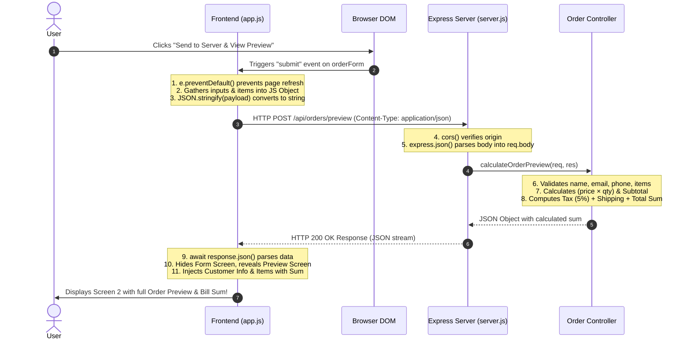

# 📦 Order & Billing Portal: Client + Server Architecture

A complete, full-stack web application built for the **Order Management and Dynamic Bill Calculation Assignment**. This project features a modern responsive client interface, an Express API backend, clear REST routing, and comprehensive client-server communication.

---

## 📁 Project Directory Structure

```text
Quiz/
├── client/
│   ├── index.html       # Screen 1 (Input Form) + Screen 2 (Order Preview & Sum) + In-App Study Guide
│   ├── style.css        # Premium responsive styling (Indigo/Slate theme, glassmorphism, animations)
│   └── app.js           # Frontend logic, dynamic item table, validation, and fetch() API communication
│
├── server/
│   ├── package.json     # Node.js dependencies (express, cors) & scripts
│   ├── server.js        # Express app initialization, middlewares, routing, and HTTP listener
│   ├── routes/
│   │   └── orderRoutes.js # REST API route definitions (GET /health, POST /preview, POST /submit)
│   └── controllers/
│       └── orderController.js # Business logic: validations, item iteration, and bill sum calculation
│
└── README.md            # Documentation, CLI commands, and line-by-line classroom exam study guide
```

---

## 💻 CLI Commands (How to Run)

### 1. Backend Server Setup & Start

Open your terminal or command prompt:

```bash
# Navigate to the server folder
cd server

# Install dependencies (only needed the first time)
npm install

# Option A: Start production server
npm start

# Option B: Start development server with auto-reload
npm run dev
```

The server will start listening at:
> `http://localhost:5000`  
> Health check: `http://localhost:5000/api/orders/health`

---

### 2. Frontend Client Setup & Run

The client is pure Vanilla HTML, CSS, and JavaScript. You can run it in two ways:

#### Option A: Using a local web server (Recommended)
```bash
# In the project root or client folder:
npx serve client
# OR
npx http-server client -p 3000
```
Then visit `http://localhost:3000` in your web browser.

#### Option B: Direct Browser Execution
Simply double-click `client/index.html` to open it in Google Chrome, Microsoft Edge, or Firefox. Because CORS is enabled on the server, API calls work seamlessly.

---

## 📡 API Endpoints & Routes Specification

| Method | Endpoint | Description | Request Body | Response Status |
| :--- | :--- | :--- | :--- | :--- |
| `GET` | `/api/orders/health` | Diagnostic health check | *None* | `200 OK` |
| `POST` | `/api/orders/preview` | Validates data & calculates bill sum | `{ personalInfo, items }` | `200 OK` / `400 Bad Request` |
| `POST` | `/api/orders/submit` | Confirms order and generates Order ID | `{ previewId, personalInfo, items, summary }` | `201 Created` / `400 Bad Request` |

### Sample `POST /api/orders/preview` Payload:
```json
{
  "personalInfo": {
    "fullName": "Abdul Rafay",
    "email": "rafay@example.com",
    "phone": "+92 300 1234567",
    "address": "House #14, Street 9, Sector F-7/2",
    "city": "Islamabad",
    "paymentMethod": "Credit / Debit Card",
    "notes": "Fragile items, deliver afternoon"
  },
  "items": [
    { "name": "Mechanical Keyboard", "price": 79.99, "quantity": 1 },
    { "name": "Wireless Mouse", "price": 29.99, "quantity": 2 }
  ]
}
```

### Sample Response:
```json
{
  "success": true,
  "message": "Order preview calculated successfully",
  "data": {
    "previewId": "PREV-657885",
    "orderDate": "10/26/2026, 9:22:15 AM",
    "personalInfo": { ... },
    "items": [
      { "id": 1, "name": "Mechanical Keyboard", "price": 79.99, "quantity": 1, "total": 79.99 },
      { "id": 2, "name": "Wireless Mouse", "price": 29.99, "quantity": 2, "total": 59.98 }
    ],
    "summary": {
      "itemCount": 3,
      "subtotal": 139.97,
      "taxRate": "5%",
      "taxAmount": 7.00,
      "shippingFee": 0.00,
      "totalBillAmount": 146.97
    }
  }
}
```

---

## 🎓 15% COURSE MARKS: Client-Server Communication Explained

This section details how your **Frontend Client communicates with the Backend Server API**, from the moment a user clicks **Submit** to the moment the **Order Preview Screen** appears.



### Detailed Breakdown of the 5 Steps:

1. **Event Interception & Preventing Default Behavior:**
   - In `client/app.js`, `orderForm.addEventListener('submit', handleFormSubmit)` intercepts the submission.
   - `e.preventDefault()` halts the default HTML form behavior (which would otherwise cause a full page refresh and lose all JavaScript state).

2. **Data Packaging (Serialization):**
   - The client queries the DOM to read the input fields: `fullName`, `email`, `phone`, `address`, `paymentMethod`, and all dynamic item rows (`name`, `price`, `quantity`).
   - It packages this into a clean JavaScript object: `{ personalInfo: {...}, items: [...] }`.
   - `JSON.stringify(payload)` converts the JavaScript object into a standardized JSON string representation suitable for network transmission.

3. **HTTP Dispatch via `fetch()`:**
   - The browser dispatches an asynchronous network request:
     ```javascript
     const response = await fetch('http://localhost:5000/api/orders/preview', {
         method: 'POST',
         headers: {
             'Content-Type': 'application/json'
         },
         body: JSON.stringify(payload)
     });
     ```
   - **`method: 'POST'`**: Informs the server that the client is transmitting a new resource/payload for processing.
   - **`headers: { 'Content-Type': 'application/json' }`**: Crucial MIME type header telling Express how to decode the payload.
   - **`body`**: The serialized JSON data payload.

4. **Server Middleware, Routing, & Computation:**
   - `cors()`: Cross-Origin Resource Sharing middleware ensures requests from different origins (e.g. `localhost:3000` to `localhost:5000`) are accepted.
   - `express.json()`: Middleware that intercepts incoming HTTP packets with `Content-Type: application/json`, parses the string stream, and attaches it as a native JavaScript object to `req.body`.
   - `orderRoutes.js`: Matches the path `/api/orders/preview` and invokes `calculateOrderPreview`.
   - `orderController.js`: Computes:
     $$\text{Item Total} = \text{Price} \times \text{Quantity}$$
     $$\text{Subtotal} = \sum \text{Item Totals}$$
     $$\text{Sales Tax} = \text{Subtotal} \times 0.05$$
     $$\text{Total Bill Amount} = \text{Subtotal} + \text{Sales Tax} + \text{Shipping Fee}$$
   - Returns `res.status(200).json({ success: true, data: ... })`.

5. **Client Response Handling & DOM Transition:**
   - The client awaits the response: `const result = await response.json()`.
   - Checks `response.ok` (HTTP 200).
   - Passes `result.data` to `renderPreviewScreen(result.data)`.
   - Toggles CSS classes: removes `active-screen` from the form and adds `active-screen` to the preview screen.

---

## ⚡ Classroom Test Survival Guide: "Lines Your Teacher Might Remove"

Your professor noted they will **remove random lines of code and ask you to identify and rewrite them on the spot**. Here are the critical lines and their symptoms:

### 1. `event.preventDefault();` (in `client/app.js`)
* **Symptom if removed**: As soon as you click submit, the page immediately flickers and refreshes! The URL bar may append `?fullName=...`, and the preview screen never displays.
* **Why**: HTML `<form>` submissions trigger a browser GET/POST page reload by default. `event.preventDefault()` stops this.
* **Fix**: Put `event.preventDefault();` as the very first line of `handleFormSubmit(event)`.

---

### 2. `app.use(express.json());` (in `server/server.js`)
* **Symptom if removed**: The server crashes with `TypeError: Cannot destructure property 'personalInfo' of 'req.body' as it is undefined`, or returns `400 Bad Request`.
* **Why**: Node's raw HTTP server receives requests as raw byte streams. Without `express.json()`, Express does not parse the incoming JSON, leaving `req.body` as `undefined`.
* **Fix**: Add `app.use(express.json());` before route declarations in `server.js`.

---

### 3. `app.use(cors());` (in `server/server.js`)
* **Symptom if removed**: In the browser console, you will see a red error:  
  `Access to fetch at 'http://localhost:5000/api/orders/preview' from origin 'http://localhost:3000' has been blocked by CORS policy: No 'Access-Control-Allow-Origin' header is present on the requested resource.`
* **Why**: Modern browsers enforce the Same-Origin Policy. Since client (port 3000) and server (port 5000) have different origins, the server must explicitly approve it via CORS headers.
* **Fix**: Add `const cors = require('cors');` and `app.use(cors());` in `server.js`.

---

### 4. `'Content-Type': 'application/json'` (in `client/app.js`)
* **Symptom if removed**: Even though `app.use(express.json())` is present on the server, `req.body` arrives as `{}` (empty object), because the server does not know how to parse the payload without the header.
* **Why**: The server's JSON parser checks the `Content-Type` header to determine if it should parse the incoming body.
* **Fix**: Ensure the `headers` property inside `fetch()` contains `'Content-Type': 'application/json'`.

---

### 5. `JSON.stringify(payload)` (in `client/app.js`)
* **Symptom if removed (e.g. passing `body: payload`)**: The browser sends `[object Object]` across the wire instead of JSON, resulting in `SyntaxError: Unexpected token o in JSON at position 1` on the server.
* **Why**: HTTP request bodies must be strings, buffers, or streams. You cannot transmit raw JavaScript memory objects directly over TCP.
* **Fix**: Wrap your payload with `JSON.stringify(...)`.

---

### 6. `await response.json();` (in `client/app.js`)
* **Symptom if removed or forgotten `await`**: `result` becomes `Promise { <pending> }`. Attempting to read `result.data` will throw `TypeError: Cannot read properties of undefined`.
* **Why**: `response.json()` is an asynchronous function that streams and parses the HTTP body. It returns a Promise that must be awaited.
* **Fix**: Always write `const result = await response.json();`.

---

### 7. `app.use('/api/orders', orderRoutes);` (in `server/server.js`)
* **Symptom if removed**: Calling `http://localhost:5000/api/orders/preview` returns `404 Not Found` with message `Route /api/orders/preview not found`.
* **Why**: The routes exist inside `orderRoutes.js`, but they must be mounted into the main Express application.
* **Fix**: Ensure `app.use('/api/orders', orderRoutes);` is present.

---

### 8. `module.exports = router;` (in `server/routes/orderRoutes.js`)
* **Symptom if removed**: Server fails to start with `TypeError: router.use() requires a middleware function but got a Object`.
* **Why**: Node.js CommonJS modules must explicitly export variables using `module.exports` so that `require('./routes/orderRoutes')` receives the configured router.
* **Fix**: Add `module.exports = router;` at the bottom of `orderRoutes.js`.

---

## 🎨 Design Features Included
- **Dynamic Items Management**: Add and remove items on the fly with live subtotal calculation.
- **Form Screen**: Structured sections for personal information, delivery details, and items.
- **Preview Screen**: Clean invoice layout with reference ID, personal info card, purchased items breakdown, and calculated bill sum.
- **Real-Time Backend Status Pill**: Detects if port 5000 is active or offline on load.
- **Autofill Demo Button**: Fills realistic test data in 1 click for in-class presentations.
- **Print Receipt**: Triggers custom clean CSS print layout for invoices.
- **Confirmation Modal**: Confirms official order submission with server-generated order ID.
