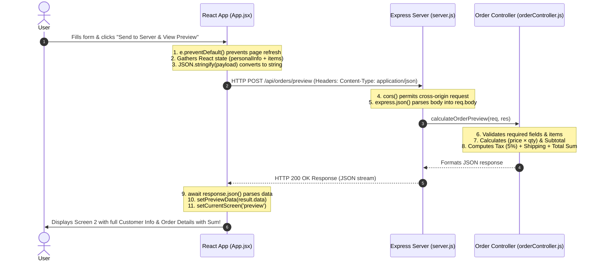

# 📦 Order & Billing Portal: Client (React + Vite) + Server (Express API)

A complete full-stack web application built for the **Order Management and Dynamic Bill Calculation Assignment**. This project features a modern responsive **React + Vite** client interface, an **Express.js API** backend, modular REST routing, and comprehensive client-server communication.

---

## 📁 Project Directory Structure

```text
Quiz/
├── client/                      # Frontend (React + Vite)
│   ├── index.html               # Main HTML entry point (Google Fonts: Outfit & Plus Jakarta Sans)
│   ├── vite.config.js           # Vite configuration (runs on port 3000)
│   ├── package.json             # React 19 & Vite dependencies
│   └── src/
│       ├── main.jsx             # React DOM root render
│       ├── App.jsx              # Main React component (State, Forms, Fetch API, Screen Toggling)
│       └── index.css            # Modern styling (Slate/Indigo theme, glassmorphism, animations)
│
├── server/                      # Backend (Node.js & Express)
│   ├── package.json             # Server dependencies (express, cors)
│   ├── server.js                # Express app initialization, CORS, JSON middleware, port listener
│   ├── routes/
│   │   └── orderRoutes.js       # API routes: GET /health, POST /preview, POST /submit
│   └── controllers/
│       └── orderController.js   # Validation, item calculations, 5% tax, shipping, and grand sum
│
└── README.md                    # Project documentation & classroom study guide
```

---

## 💻 CLI Commands (How to Run)

To run the project, you need **two terminal tabs**:

### 1. Backend Server (Express API)

```bash
# Navigate to the server folder
cd server

# Install dependencies (only required the first time)
npm install

# Start the server (Runs on port 5000)
npm start
# OR using nodemon for automatic reload:
nodemon server.js
```

> **API Base URL:** `http://localhost:5000`  
> **Health Check Endpoint:** `http://localhost:5000/api/orders/health`

---

### 2. Frontend Client (React + Vite)

```bash
# Navigate to the client folder (in a new terminal tab)
cd client

# Install dependencies (only required the first time)
npm install

# Start the Vite development server (Runs on port 3000)
npm run dev
```

> **Frontend Application:** `http://localhost:3000`

---

## 📡 API Endpoints & Routes Specification

| Method | Endpoint | Description | Request Body | Response Status |
| :--- | :--- | :--- | :--- | :--- |
| `GET` | `/api/orders/health` | Diagnostic health check | *None* | `200 OK` |
| `POST` | `/api/orders/preview` | Validates inputs & calculates order bill sum | `{ personalInfo, items }` | `200 OK` / `400 Bad Request` |
| `POST` | `/api/orders/submit` | Confirms final order & generates Order ID | `{ previewId, personalInfo, items, summary }` | `201 Created` / `400 Bad Request` |

### Sample `POST /api/orders/preview` Request Payload:
```json
{
  "personalInfo": {
    "fullName": "Abdul Rafay",
    "email": "rafay@example.com",
    "phone": "+92 300 1234567",
    "paymentMethod": "Credit / Debit Card",
    "address": "Apartment 4B, Blue Area Commercial Ave",
    "city": "Islamabad",
    "notes": "Please deliver after 2:00 PM."
  },
  "items": [
    { "name": "Mechanical RGB Keyboard", "price": 79.99, "quantity": 1 },
    { "name": "Wireless Gaming Mouse", "price": 34.50, "quantity": 2 }
  ]
}
```

### Sample Response (`200 OK`):
```json
{
  "success": true,
  "message": "Order preview calculated successfully",
  "data": {
    "previewId": "PREV-657885",
    "orderDate": "10/26/2026, 12:45:10 PM",
    "personalInfo": { ... },
    "items": [
      { "id": 1, "name": "Mechanical RGB Keyboard", "price": 79.99, "quantity": 1, "total": 79.99 },
      { "id": 2, "name": "Wireless Gaming Mouse", "price": 34.50, "quantity": 2, "total": 69.00 }
    ],
    "summary": {
      "itemCount": 3,
      "subtotal": 148.99,
      "taxRate": "5%",
      "taxAmount": 7.45,
      "shippingFee": 0.00,
      "totalBillAmount": 156.44
    }
  }
}
```

---

## 🎓 15% COURSE MARKS: How Client Communicates with Server (Frontend with API)

Below is the detailed flow explaining how the **React Frontend** communicates with the **Express Backend API**:



### Detailed Breakdown of the 5 Sequential Steps:

1. **Event Interception (`e.preventDefault()`):**
   In `client/src/App.jsx`, when the user clicks the submit button, the `onSubmit` event triggers `handleFormSubmit(e)`. `e.preventDefault()` stops the default browser behavior of submitting a form (which would cause a full page refresh and lose React's state).

2. **Data Packaging & Serialization (`JSON.stringify`):**
   React extracts data directly from its component state (`personalInfo` and `items`). It formats the payload into a JavaScript object:
   ```javascript
   const payload = {
     personalInfo,
     items: formattedItems
   };
   ```
   `JSON.stringify(payload)` converts the JavaScript object into a standardized JSON string suitable for transmission over HTTP.

3. **HTTP Dispatch via `fetch()`:**
   The browser initiates an asynchronous network call:
   ```javascript
   const response = await fetch('http://localhost:5000/api/orders/preview', {
     method: 'POST',
     headers: {
       'Content-Type': 'application/json'
     },
     body: JSON.stringify(payload)
   });
   ```
   - **`method: 'POST'`**: Tells the server we are sending new data to process.
   - **`headers: { 'Content-Type': 'application/json' }`**: Specifies that the payload is formatted as JSON.
   - **`body`**: Contains the JSON string.

4. **Server Middleware, Routing & Calculation:**
   - **`app.use(cors())`**: Ensures that requests from port `3000` (React) are accepted by port `5000` (Express).
   - **`app.use(express.json())`**: Parses incoming JSON request bodies and makes them accessible as `req.body`.
   - **`orderRoutes.js`**: Matches the `/preview` route and invokes `calculateOrderPreview`.
   - **`orderController.js`**: Validates fields, calculates each item's total ($price \times quantity$), computes subtotal, 5% sales tax, shipping fee, and grand total sum.
   - Returns: `res.status(200).json({ success: true, data: ... })`.

5. **Client Response Handling & View Switching:**
   - The React client parses the incoming response using `const result = await response.json()`.
   - It updates state via `setPreviewData(result.data)`.
   - It transitions the view by calling `setCurrentScreen('preview')`, which causes React to render the second screen with customer details and the calculated bill sum.

---

## 🚨 Classroom Test Cheatsheet: "Lines Your Teacher Might Remove"

If your professor removes lines of code in class to test your understanding, use this table to quickly identify and replace them:

| Removed Line | File Location | Symptoms & Errors | How to Fix It |
| :--- | :--- | :--- | :--- |
| **`e.preventDefault();`** | `client/src/App.jsx` (top of `handleFormSubmit`) | Page immediately flickers and refreshes on submit; URL bar appends query params like `?fullName=...`; preview screen never appears. | Place `e.preventDefault();` at the very beginning of `handleFormSubmit(e)`. |
| **`app.use(express.json());`** | `server/server.js` | Server crashes with: `TypeError: Cannot destructure property 'personalInfo' of req.body as it is undefined`. | Add `app.use(express.json());` before route definitions in `server.js`. |
| **`app.use(cors());`** | `server/server.js` | Browser console throws a red error: `Access to fetch blocked by CORS policy: No 'Access-Control-Allow-Origin' header present`. | Add `const cors = require('cors');` and `app.use(cors());` in `server.js`. |
| **`'Content-Type': 'application/json'`** | `client/src/App.jsx` inside `fetch()` headers | `req.body` arrives on the server as an empty `{}` object even though data was sent. | Ensure `headers: { 'Content-Type': 'application/json' }` is included in `fetch()` options. |
| **`JSON.stringify(payload)`** | `client/src/App.jsx` inside `fetch()` body | Server throws `SyntaxError: Unexpected token o in JSON at position 1` because browser sent `[object Object]`. | Wrap the payload in `body: JSON.stringify(payload)`. |
| **`await response.json();`** | `client/src/App.jsx` | `result` is a `Promise { <pending> }` instead of the data object, causing `TypeError: Cannot read properties of undefined`. | Ensure you use `const result = await response.json();`. |
| **`app.use('/api/orders', orderRoutes);`** | `server/server.js` | Client receives `404 Not Found` with message `Route /api/orders/preview not found on this server`. | Mount the router using `app.use('/api/orders', orderRoutes);` in `server.js`. |
| **`module.exports = router;`** | `server/routes/orderRoutes.js` | Server fails to start with: `TypeError: router.use() requires a middleware function`. | Add `module.exports = router;` at the bottom of `orderRoutes.js`. |
